# 🛒 Mercado Express + 🏦 Banco Tranquilo: Microsserviços com RabbitMQ

**Checkpoint 5, Parte 2 (Microsserviços com RabbitMQ, Spring de Mensageria com API e e-mail)**
FIAP · Tecnologia em Análise e Desenvolvimento de Sistemas (TDS) · Java Advanced · Prof. Dr. Marcel Stefan Wagner

Dois microsserviços **Spring Boot** conversam pelo **RabbitMQ**:

- **`mercado-express-api`**: loja com carrinho, API REST de compra (`POST /pagamentos`), consumidores das respostas do banco, **envio de e-mail** de confirmação e **Dashboard da gerência**.
- **`banco-tranquilo-worker`**: a *API do Banco Tranquilo*. Consome as requisições de pagamento, valida conta e saldo do cliente e responde com **sucesso** ou **erro**.

Quando o Banco Tranquilo **aprova** a compra, o Mercado Express marca o pedido como **PAGO**, baixa o estoque, **envia um e-mail** de confirmação ao comprador e **grava o envio no PostgreSQL** (tabela de controle de e-mails).

| | |
|---|---|
| 💻 **IDE utilizada** | IntelliJ IDEA |
| 🐇 **Broker** | RabbitMQ 3.13 (Docker), Dashboard em http://localhost:15672 (guest/guest) |
| 🗄️ **Banco de dados** | PostgreSQL 16 (o mesmo da Parte 1) |
| ✉️ **E-mail** | SMTP local com MailHog/Mailpit, caixa em http://localhost:8025 |
| 🎬 **Vídeo** | Enviado em .mp4 junto com a entrega no Teams |

---

## 📑 Sumário
1. [Integrantes](#-integrantes)
2. [Arquitetura](#-arquitetura)
3. [Exchanges e filas](#-exchanges-e-filas-rabbitmq)
4. [Fluxo da compra](#-fluxo-da-compra)
5. [Modelo de dados](#-modelo-de-dados)
6. [Configuração do BD (para o professor)](#-configuração-do-bd)
7. [Como executar](#-como-executar)
8. [Testes: Postman, script e RabbitMQ Monitor](#-testes)
9. [Telas](#-telas)
10. [Estrutura do projeto](#-estrutura-do-projeto)

---

## 👥 Integrantes

| Nome | RM |
|---|---|
| Erick Bernardes Bradaschia | RM565733 |
| Gabriel Santos Claudino | RM564054 |
| Jonathan Moreira Gomes | RM565060 |
| Kaiky de Oliveira Silva | RM566067 |
| Lucas Fortes de Lima | RM559523 |

Turma **2TDSR**, curso **TDS**.

---

## 🏗️ Arquitetura

Mesma estrutura do exemplo da aula (`demo-backend-api` + `demo-backend-worker`), com os pacotes `api`, `facade`, `producer`, `consumer` e `dto`.

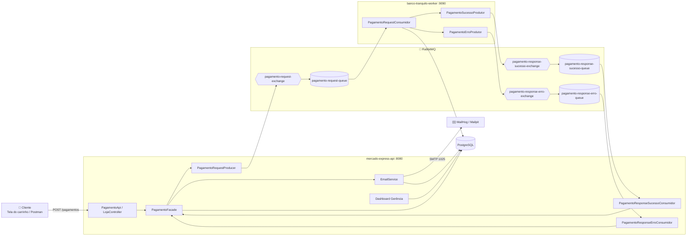

---

## 🐇 Exchanges e filas (RabbitMQ)

| Exchange (direct) | Routing key | Fila | Quem publica | Quem consome |
|---|---|---|---|---|
| `pagamento-request-exchange` | `pagamento-request-rout-key` | `pagamento-request-queue` | Mercado Express | Banco Tranquilo |
| `pagamento-response-sucesso-exchange` | `pagamento-response-sucesso-rout-key` | `pagamento-response-sucesso-queue` | Banco Tranquilo | Mercado Express |
| `pagamento-response-erro-exchange` | `pagamento-response-erro-rout-key` | `pagamento-response-erro-queue` | Banco Tranquilo | Mercado Express |

As exchanges, filas e bindings são declarados em `config/RabbitConfig.java` (criados automaticamente ao subir a aplicação). Também podem ser criados manualmente pelo Dashboard do RabbitMQ, como fizemos em aula.

---

## 🔄 Fluxo da compra

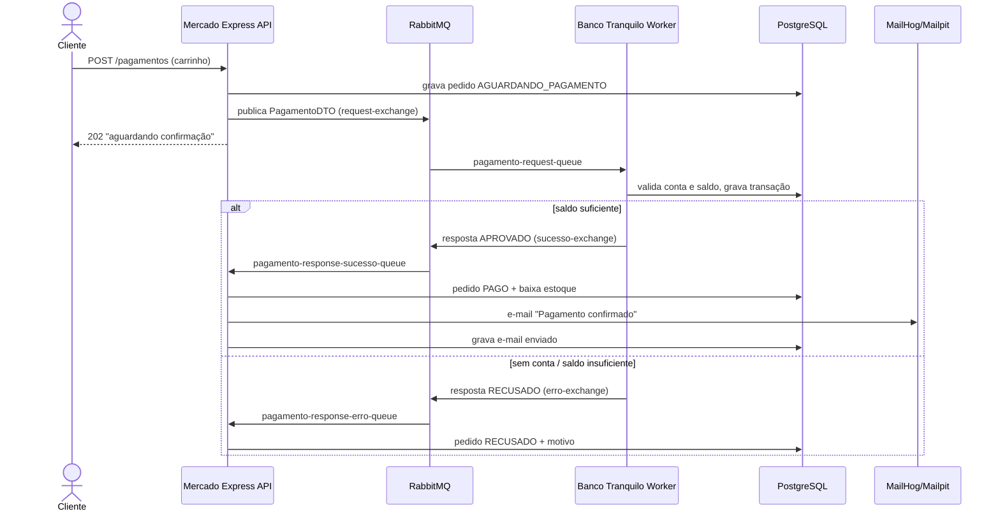

**Regras do Banco Tranquilo:** aprova se a conta (pelo e-mail) existe e tem saldo ≥ valor da compra, e então debita o saldo e gera um código de autorização `BT-XXXXXXXX`. Caso contrário, recusa com o motivo.

| Conta de teste | Saldo inicial | Resultado esperado |
|---|---|---|
| `ana@tranquilo.com` | R$ 5.000,00 | Aprovada |
| `bruno@tranquilo.com` | R$ 1.500,00 | Aprovada |
| `carla@tranquilo.com` | R$ 20,00 | Recusada (saldo insuficiente) |
| qualquer outro e-mail | n/a | Recusada (conta não encontrada) |

---

## 🗄️ Modelo de dados

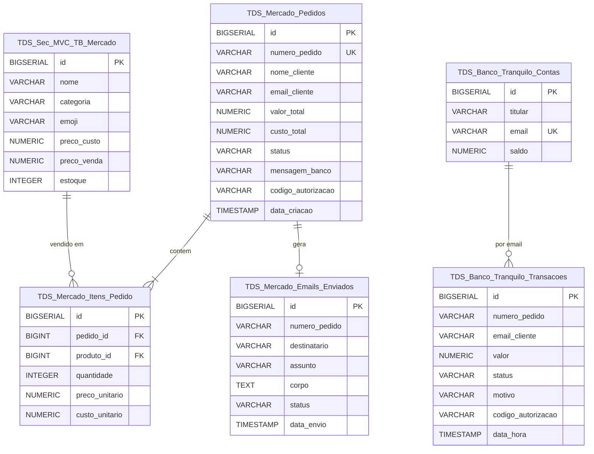

---

## 🗄️ Configuração do BD

PostgreSQL 16 (o mesmo da Parte 1), criado pelo `docker-compose.yml`:

| Item | Valor |
|---|---|
| Host | `localhost` |
| Porta | `5433` |
| Database | `mercado` |
| Usuário | `mercado` |
| Senha | `mercado123` |
| JDBC URL | `jdbc:postgresql://localhost:5433/mercado` |

`application.yml` (os dois serviços):

```yaml
spring:
  datasource:
    url: ${DB_URL:jdbc:postgresql://localhost:5433/mercado}
    username: ${DB_USER:mercado}
    password: ${DB_PASSWORD:mercado123}
  jpa:
    hibernate:
      ddl-auto: update
  rabbitmq:
    host: ${RABBIT_HOST:localhost}
    port: 5672
    username: guest
    password: guest
  mail:            # só no mercado-express-api
    host: localhost
    port: 1025
```

---

## ▶️ Como executar

Pré-requisitos: Java 21, Maven e Docker.

```bash
# 1. Subir RabbitMQ + PostgreSQL + MailHog/Mailpit
docker compose up -d

# 2. Subir o Banco Tranquilo (porta 9090)
cd banco-tranquilo-worker && mvn spring-boot:run

# 3. Em outro terminal, subir o Mercado Express (porta 8080)
cd mercado-express-api && mvn spring-boot:run
```

No IntelliJ: abrir cada pasta e executar `BancoTranquiloWorkerApplication` e `MercadoExpressApiApplication`.

| O quê | Endereço |
|---|---|
| 🛒 Loja / carrinho | http://localhost:8080 |
| 📊 Dashboard da gerência | http://localhost:8080/dashboard |
| 🐇 RabbitMQ Dashboard | http://localhost:15672 (guest / guest) |
| ✉️ Caixa de e-mail (MailHog/Mailpit) | http://localhost:8025 |

---

## 🧪 Testes

### Postman
Importe [`testes/CP5-Mercado-Express.postman_collection.json`](testes/CP5-Mercado-Express.postman_collection.json). Ela tem compra aprovada, compras recusadas, erro de estoque, consulta de status, e-mails e dashboard.

**Exemplo de requisição de compra (JSON):**

```http
POST http://localhost:8080/pagamentos
Content-Type: application/json
```
```json
{
  "nomeCliente": "Ana Souza",
  "emailCliente": "ana@tranquilo.com",
  "itens": [
    { "produtoId": 1, "quantidade": 3 },
    { "produtoId": 8, "quantidade": 1 }
  ]
}
```

Resposta imediata (**202 Accepted**). O pagamento segue assíncrono pelo RabbitMQ:
```json
{ "numeroPedido": "ME-20261017084550-742", "status": "AGUARDANDO_PAGAMENTO", "valorTotal": 50.87,
  "mensagem": "Pagamento aguardando confirmacao do Banco Tranquilo..." }
```

Consulta depois da resposta do banco: `GET http://localhost:8080/pagamentos/ME-20261017084550-742`
```json
{ "numeroPedido": "ME-20261017084550-742", "status": "PAGO", "cliente": "Ana Souza",
  "itens": "3x Banana Prata (kg), 1x Kit 3 Meias Esportivas", "valorTotal": 50.87,
  "mensagemBanco": "Pagamento aprovado pelo Banco Tranquilo", "codigoAutorizacao": "BT-E0E65F0F" }
```

### Script de testes
```bash
./testes/testar-fluxo.sh
```

### Teste interno pelo RabbitMQ Monitor (Dashboard)
1. Acesse http://localhost:15672, aba **Exchanges**, e clique em `pagamento-request-exchange`.
2. Em **Publish message**, use a routing key `pagamento-request-rout-key` e um payload, por exemplo:
   ```json
   {"numeroPedido":"TESTE-MONITOR-1","valor":30.00,"produto":"Teste pelo Dashboard","nomeCliente":"Ana Souza","emailCliente":"ana@tranquilo.com"}
   ```
3. Clique em **Publish message**. O log do `banco-tranquilo-worker` mostra a requisição e a transação fica gravada em `TDS_Banco_Tranquilo_Transacoes`.
4. Para ver a mensagem de resposta "parada" na fila, pare o `mercado-express-api`, publique de novo e use **Queues → pagamento-response-sucesso-queue → Get messages**.

---

## 🖥️ Telas

### Loja (catálogo do Mercado Express)
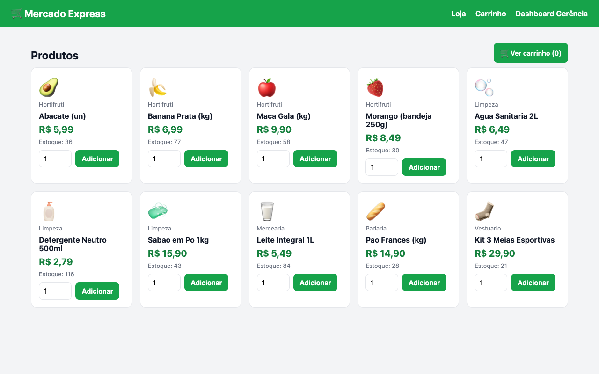

### Carrinho e finalização da compra (integração com o Banco Tranquilo)
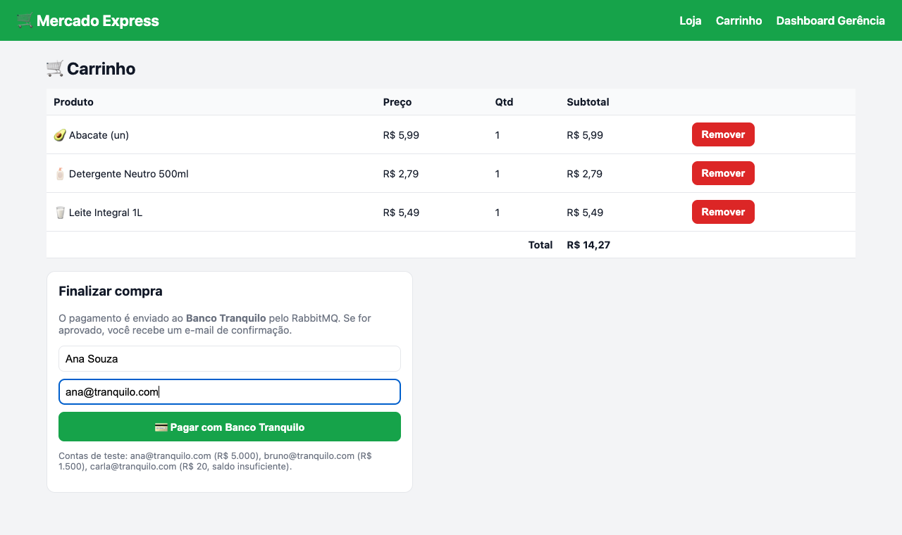

### Pedido aprovado: e-mail enviado
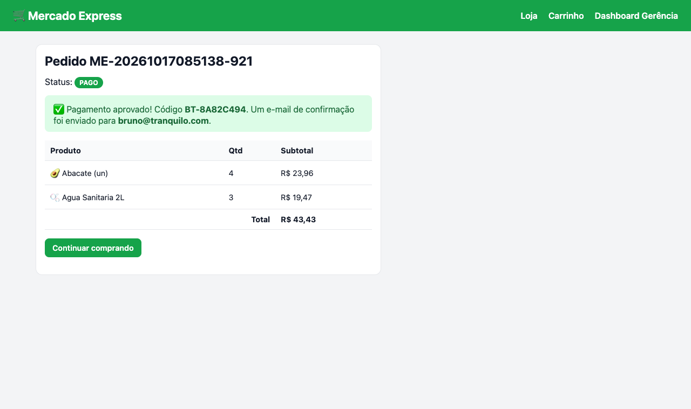

### Pedido recusado pelo banco
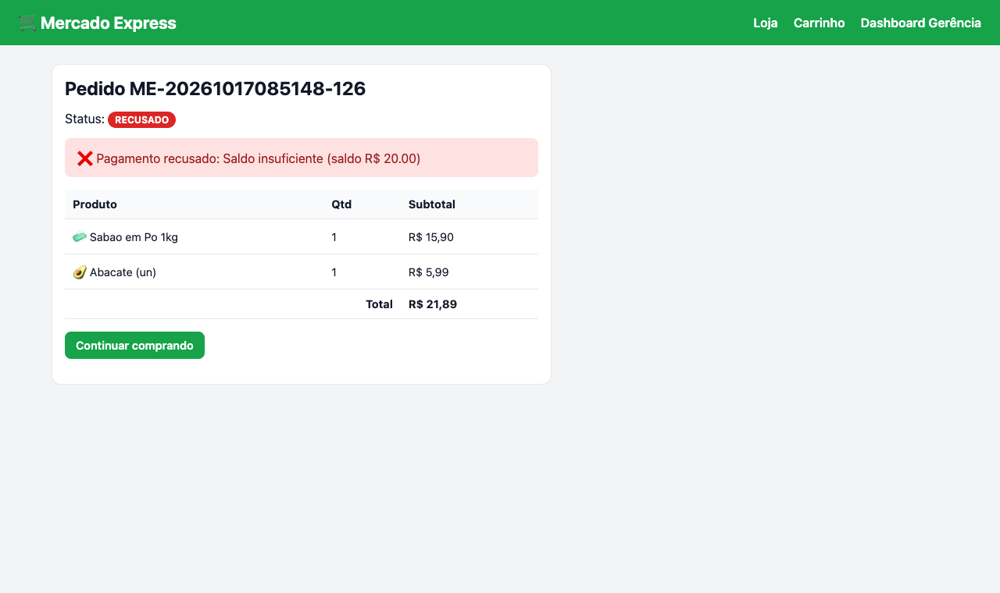

### Dashboard da gerência: compras, vendas, lucro, estoque e controle de e-mails
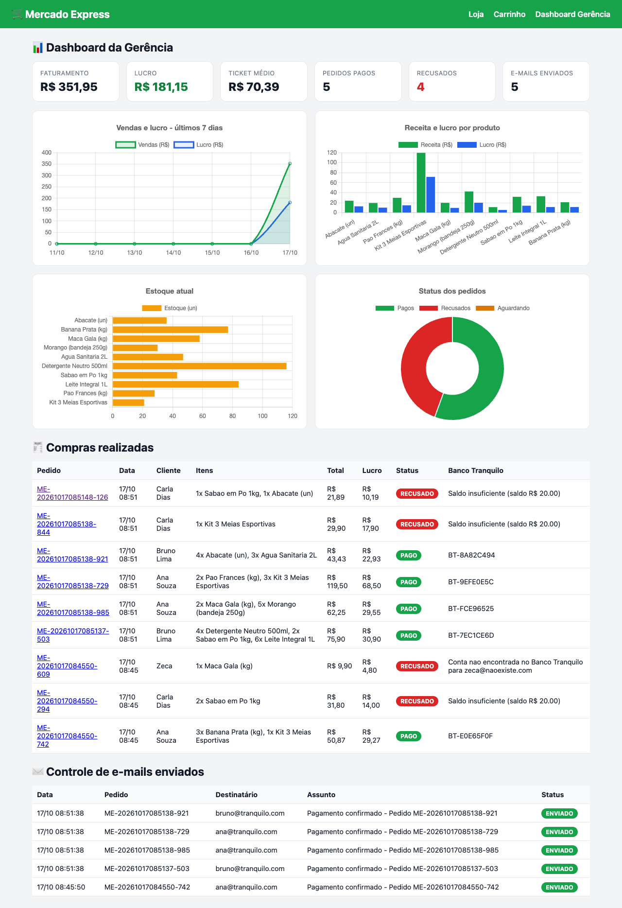

### Caixa de e-mail (MailHog/Mailpit) com o aviso de confirmação de pagamento
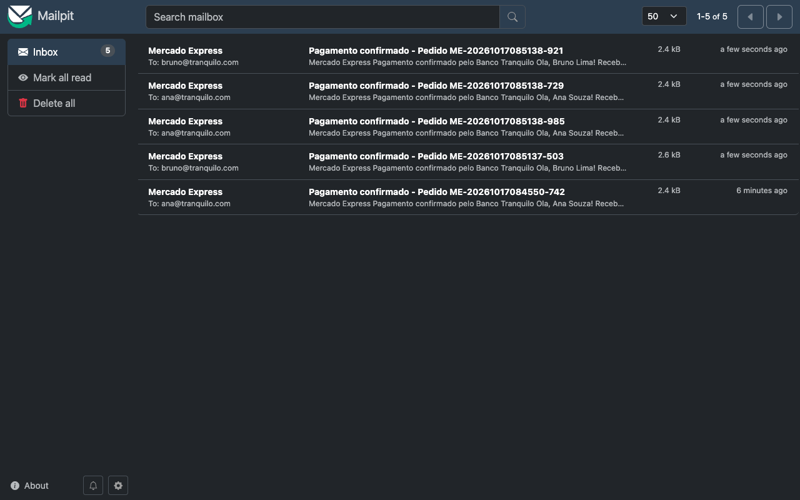
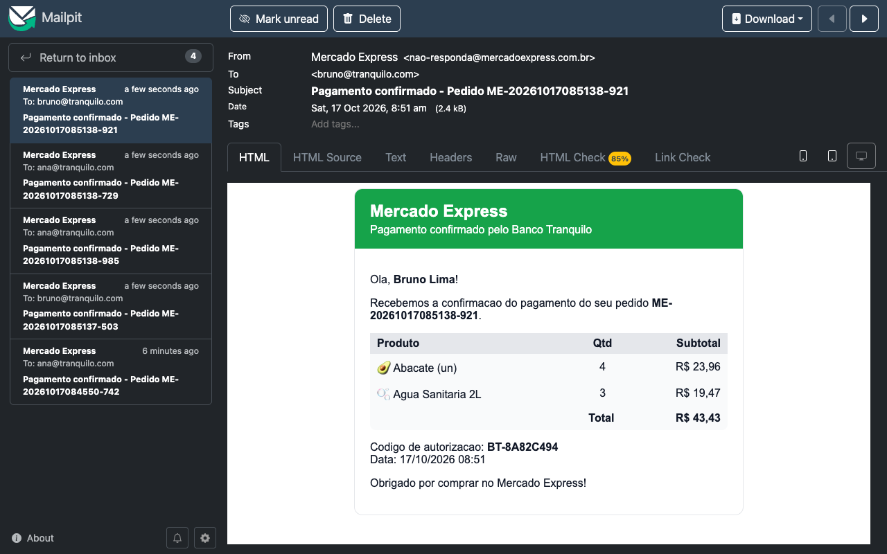

### RabbitMQ Dashboard
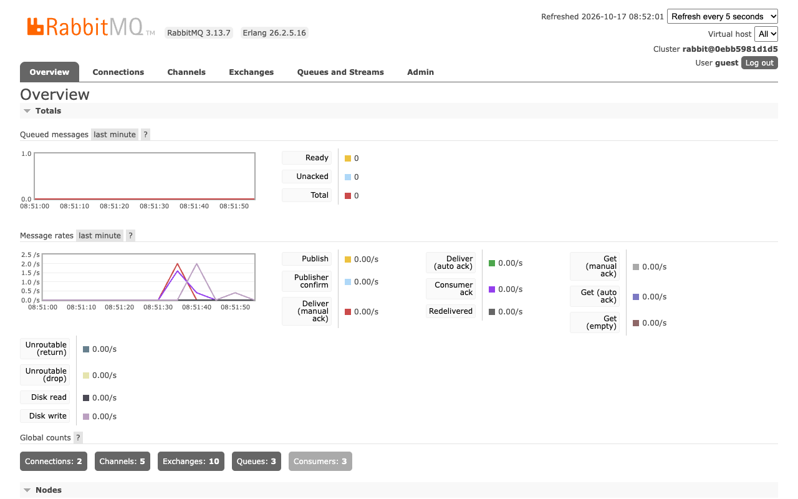
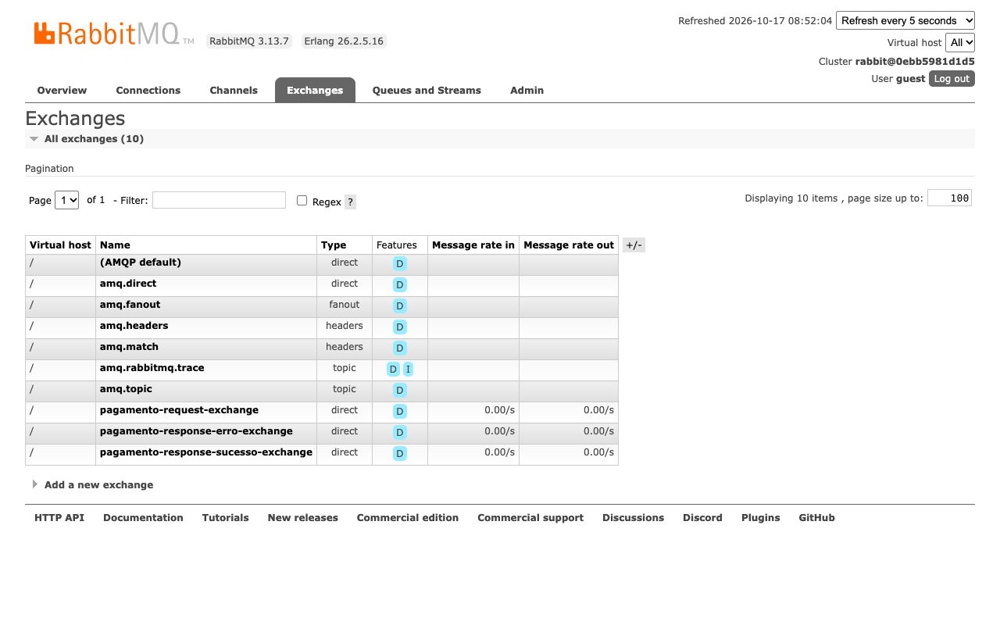
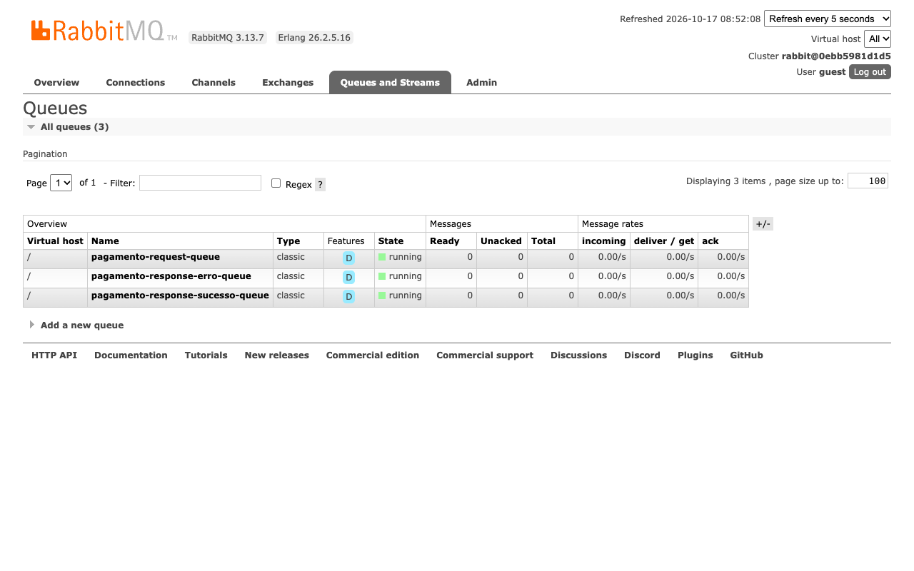

---

## 📁 Estrutura do projeto

```
cp5-parte2/
├── docker-compose.yml                 # RabbitMQ + PostgreSQL + MailHog/Mailpit
├── testes/                            # collection Postman, JSON de exemplo e script de testes
├── mercado-express-api/               # porta 8080
│   └── src/main/java/br/com/fiap/mercado
│       ├── api/          PagamentoApi (POST/GET /pagamentos), MercadoApi (/api/produtos, /api/emails, /api/dashboard)
│       ├── config/       RabbitConfig (exchanges/filas/bindings), DataLoader (produtos)
│       ├── consumer/     PagamentoResponseSucessoConsumidor, PagamentoResponseErroConsumidor
│       ├── dto/          PagamentoDTO, PagamentoRespostaDTO, CompraRequestDTO, CompraResponseDTO
│       ├── facade/       PagamentoFacade (regras da compra)
│       ├── model/        Produto, Pedido, ItemPedido, EmailEnviado, StatusPedido
│       ├── producer/     PagamentoRequestProducer
│       ├── repository/   Spring Data JPA
│       ├── service/      EmailService (envio + registro no BD), DashboardService (indicadores)
│       └── web/          LojaController (loja/carrinho/pedido), DashboardController
└── banco-tranquilo-worker/            # porta 9090
    └── src/main/java/br/com/fiap/banco
        ├── config/       RabbitConfig, DataLoader (contas)
        ├── consumer/     PagamentoRequestConsumidor (API do Banco Tranquilo)
        ├── dto/          PagamentoDTO, PagamentoRespostaDTO
        ├── model/        ContaBancaria, TransacaoBancaria
        ├── producer/     PagamentoSucessoProdutor, PagamentoErroProdutor
        └── repository/
```
